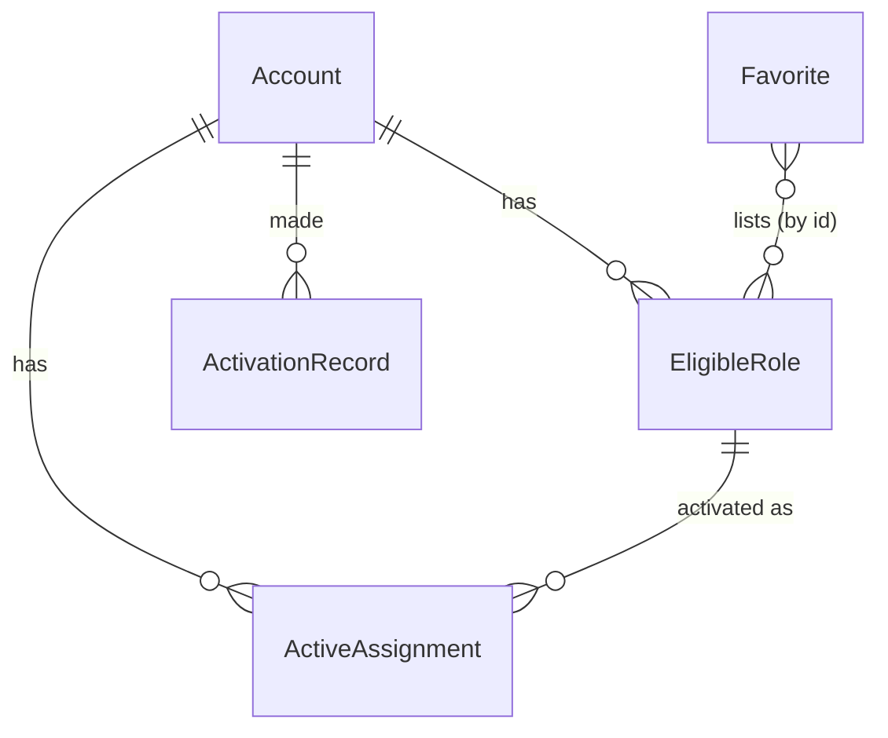

# AzurePim — Backend schema

AzurePim has **no server**. Microsoft (Azure Resource Manager and Microsoft Graph) is the source of truth for roles;
this document describes the **local SwiftData store** on the user's Mac and the remote objects it mirrors.

## Entities

- **Account** — a Microsoft identity signed in to AzurePim, with its sign-in mode (Azure CLI or MSAL) and tenant.
- **EligibleRole** — a cached eligible PIM assignment (Azure resource role, Entra role or PIM group) the account can activate.
- **ActiveAssignment** — a cached currently active PIM activation, with its end time.
- **Favorite** — a named set of eligible roles activated together, with default duration and justification per role.
- **ActivationRecord** — one request sent by AzurePim (activate, deactivate, extend), with status and timing.
- **AppSettings** — the single row of user preferences (refresh interval, notification lead time, retention, menu bar style).

## Tables / collections

### Account

| Field | Type | Required | Default | Notes |
|---|---|---|---|---|
| id | UUID | yes | generated | primary key |
| mode | enum `azureCLI` \| `msal` | yes | — | |
| upn | String | yes | — | e.g. `v.lauriat-adm@voltalia.com` |
| objectId | String (GUID) | yes | — | principal id used in requests |
| tenantId | String (GUID) | yes | — | |
| tenantName | String | no | nil | display name |
| msalHomeAccountId | String | no | nil | MSAL only; token itself stays in Keychain |
| directoryAccess | enum `notApplicable` \| `notRequested` \| `consentRequired` \| `enabled` | yes | `notApplicable` (CLI) / `notRequested` (MSAL) | |
| sortOrder | Int | yes | 0 | |
| lastRefreshAt | Date | no | nil | |

Indexes: unique (`tenantId`, `objectId`, `mode`).

### EligibleRole

| Field | Type | Required | Default | Notes |
|---|---|---|---|---|
| id | String | yes | — | primary key = remote eligibility schedule id (ARM `roleEligibilityScheduleId`, Graph `roleEligibilityScheduleId` / group `eligibilityScheduleId`) |
| account | → Account | yes | — | |
| source | enum `azureResource` \| `entraRole` \| `pimGroup` | yes | — | |
| roleDefinitionId | String | yes | — | ARM role definition id, Entra role definition id, or `member`/`owner` for groups |
| roleName | String | yes | — | |
| scope | String | yes | — | ARM scope path, `/` or AU id for Entra, group id for PIM groups |
| scopeName | String | yes | — | |
| scopeType | String | yes | — | managementgroup, subscription, resourcegroup, resource, directory, group |
| memberType | enum `direct` \| `group` \| `inherited` | yes | `direct` | |
| maxDuration | String (ISO 8601) | no | nil | from policy, e.g. `PT8H` |
| requiresJustification | Bool | yes | true | from policy |
| requiresTicket | Bool | yes | false | from policy |
| requiresMFA | Bool | yes | false | from policy |
| requiresApproval | Bool | yes | false | from policy |
| policyFetchedAt | Date | no | nil | policy cache, refreshed every 24 h |
| lastJustification | String | no | nil | prefill |
| fetchedAt | Date | yes | now | |

Indexes: (`account`, `source`), `roleName`.

### ActiveAssignment

| Field | Type | Required | Default | Notes |
|---|---|---|---|---|
| id | String | yes | — | remote assignment schedule instance id |
| account | → Account | yes | — | |
| eligibleRole | → EligibleRole | no | nil | nil for permanent assignments shown read-only |
| source | enum (same as EligibleRole) | yes | — | |
| roleName, scope, scopeName | String | yes | — | |
| assignmentType | enum `activated` \| `assigned` | yes | — | `assigned` = permanent, cannot be deactivated |
| startAt | Date | yes | — | |
| endAt | Date | no | nil | nil = permanent |
| notifiedAt | Date | no | nil | expiry notification already sent |
| fetchedAt | Date | yes | now | |

Indexes: (`account`), `endAt`.

### Favorite

| Field | Type | Required | Default | Notes |
|---|---|---|---|---|
| id | UUID | yes | generated | |
| name | String | yes | — | 1–40 chars, unique |
| sortOrder | Int | yes | 0 | |
| items | [FavoriteItem] (embedded Codable) | yes | [] | each: `eligibleRoleId`, `duration` (ISO 8601, default `PT8H` capped by policy), `justification` (String?) |

Indexes: unique `name`.

### ActivationRecord

| Field | Type | Required | Default | Notes |
|---|---|---|---|---|
| id | UUID | yes | generated | |
| account | → Account | yes | — | |
| eligibleRoleId | String | yes | — | kept even if the role disappears |
| roleName, scopeName | String | yes | — | snapshot |
| source | enum | yes | — | |
| action | enum `activate` \| `deactivate` \| `extend` | yes | — | |
| requestedDuration | String (ISO 8601) | no | nil | |
| justification | String | no | nil | |
| ticketNumber | String | no | nil | |
| remoteRequestId | String | no | nil | ARM / Graph request id |
| status | enum `sent` \| `provisioned` \| `pendingApproval` \| `denied` \| `canceled` \| `failed` | yes | `sent` | |
| errorMessage | String | no | nil | |
| panelOpenedAt | Date | no | nil | for Activation timing |
| sentAt | Date | yes | now | |
| completedAt | Date | no | nil | status became provisioned |
| viaFavorite | String | no | nil | favorite name |

Derived: `timeToActivation = completedAt − panelOpenedAt` (only when both exist). Indexes: `sentAt` desc, `status`.

### AppSettings

| Field | Type | Required | Default |
|---|---|---|---|
| refreshIntervalMinutes | Int | yes | 5 |
| notificationLeadMinutes | Int | yes | 15 |
| historyRetentionDays | Int | yes | 90 |
| menuBarStyle | enum `icon` \| `iconCount` \| `iconCountTime` | yes | `iconCountTime` |
| azCLIPath | String | no | nil (auto-detect) |
| customClientId | String | no | nil (use AzurePim multi-tenant app) |
| launchAtLogin | Bool | yes | true |

## Relations

- Account 1–n EligibleRole, ActiveAssignment, ActivationRecord (cascade delete).
- EligibleRole 1–n ActiveAssignment (nullify on delete).
- Favorite n–n EligibleRole through embedded `FavoriteItem.eligibleRoleId` (soft reference: a favorite survives a role that disappears and shows it as "no longer eligible").
- AppSettings: single row, no relation.

## Data ownership

Everything belongs to the single macOS user running the app. Remote objects (eligibilities, assignments, requests,
policies) belong to the user's tenant; AzurePim only caches them.

## Authentication flow

- No AzurePim account, no sign-up, no password reset.
- **Azure CLI mode:** token obtained on demand with `az account get-access-token`; session lifetime = the CLI's (refresh token ≈ 90 days, subject to conditional access). Expired → banner "run `az login`".
- **MSAL mode:** interactive sign-in in the system browser (or Enterprise SSO plug-in), silent token renewal from the Keychain cache; claims challenge → interactive re-auth. Sign-out removes the account from MSAL cache and the store.

## Authorization rules

No AzurePim accounts or roles: the single local macOS user has full read / create / update / delete access to
**Account**, **EligibleRole**, **ActiveAssignment**, **Favorite**, **ActivationRecord** and **AppSettings**. This is
acceptable because the store is in the user's own Library folder, contains no token, and what the user may do in
Azure / Entra is enforced server-side by Microsoft (RBAC, PIM policies, consent) on every request.

## Data validation

| Field | Rule |
|---|---|
| Favorite.name | 1–40 chars, trimmed, unique (case-insensitive) |
| Favorite.items | ≥ 1 item; durations ≤ the role's `maxDuration` when known |
| justification | 0–500 chars; required when `requiresJustification` |
| ticketNumber | 1–100 chars when `requiresTicket` |
| duration | ISO 8601 `PT<n>H` / `PT<n>M`, 5 min ≤ d ≤ policy max (default cap 24 h) |
| AppSettings | refresh 1–30 min, lead 5–60 min, retention 7–365 days |
| azCLIPath | must be an executable file named `az` |
| customClientId | GUID format |

Business rules: deactivation disabled within 5 minutes of activation (Azure rule); a role with an active
`pendingApproval` request cannot be activated again; permanent assignments (`assigned`) are read-only.

## Retention and deletion

- ActivationRecord deleted after `historyRetentionDays` (daily cleanup on launch).
- EligibleRole / ActiveAssignment are caches, replaced at each refresh; removed with their Account.
- "Delete all local data" in Settings wipes the SwiftData store and MSAL cache.
- Export: History → CSV.
- GDPR: personal data (UPN, justifications) stays on the user's Mac; no processor involved besides Microsoft, already the user's identity provider.

## Migrations and seed data

- Seed: one `AppSettings` row with defaults on first launch; nothing else.
- Schema changes via SwiftData `VersionedSchema` + `SchemaMigrationPlan`; caches (EligibleRole, ActiveAssignment) may simply be dropped and re-fetched on migration.
