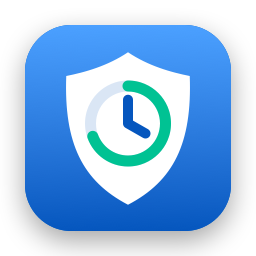
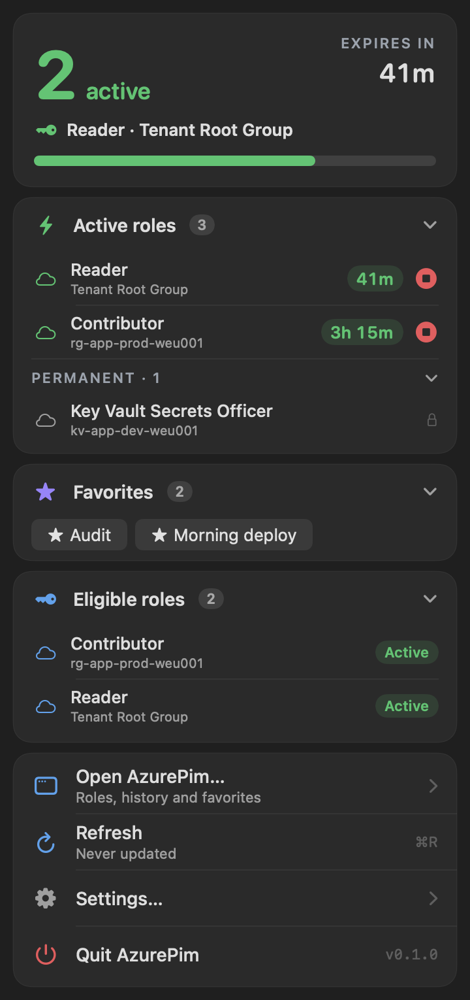
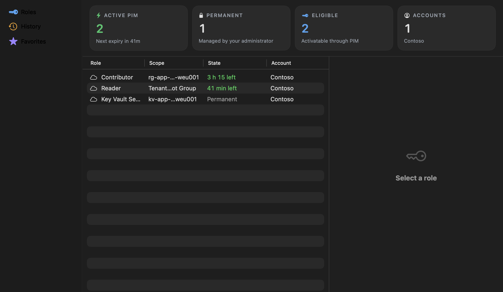
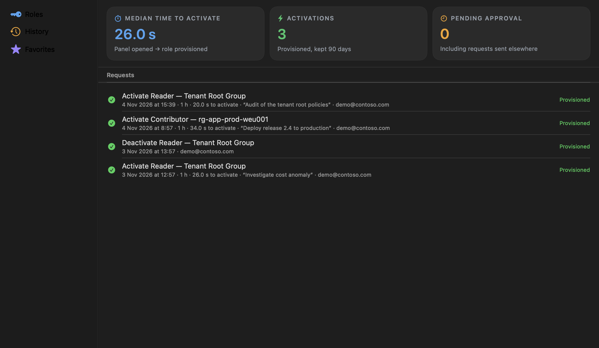

<p align="center">
  
</p>

<h1 align="center">AzurePim</h1>

<p align="center">
  Your Microsoft PIM roles in the macOS menu bar: see what is active, activate, extend and end roles,
  without opening the Azure portal.
</p>

<p align="center">
  <a href="https://vincentlauriat.github.io/AzurePim/">Website</a> ·
  <a href="#install">Install</a> ·
  <a href="#sign-in">Sign-in</a> ·
  <a href="#privacy-and-security">Privacy</a> ·
  <a href="LICENSE">MIT license</a>
</p>

<p align="center">
  
</p>

> **Status: 0.9, pre-1.0.** The signed DMG signs in with Azure CLI only: Microsoft sign-in (Entra roles and PIM
> groups) is disabled until the app registration exists, and comes with 1.0.

## Why

Privileged Identity Management (PIM) gives you roles *just in time*: you activate a role for a few hours, with a
justification, then it expires. In the portal that is 6 to 10 clicks per role, and nothing tells you that a role is
about to end in the middle of a deployment. AzurePim keeps all of it one click away in the menu bar.

## Features

| | |
|---|---|
| **Active roles at a glance** | The panel opens on the number of active PIM roles, the next expiry and a progress bar; permanent roles are listed too. |
| **Menu bar countdown** | `2 · 0:41` next to the key icon, orange at 15 minutes, red at 5. |
| **One-click activation** | Duration capped by the role policy, last justification pre-filled, ticket field when the policy asks for one. |
| **Deactivate** | End a role as soon as you are done (Azure refuses it in the first 5 minutes; the button says so). |
| **Expiry notifications** | A reminder before the end, with an **Extend** button. |
| **Favorites** | Activate several roles in one click, from the panel or `azurepim://activate?favorite=<name>` (always confirmed). |
| **History** | Every request, pending approvals (including ones sent from the portal) with **Cancel**, CSV export, median time to activate. |
| **Roles window** | Search and filter every role, see its policy: maximum duration, justification, ticket, MFA, approval. |
| **Several accounts and tenants** | One panel, filter per account. |
| **Three PIM sources** | Azure resource roles, Entra roles and PIM for Groups (the last two need the Microsoft sign-in, see below). |

<p align="center">
  
</p>
<p align="center">
  
</p>

Screenshots use demo data (Contoso).

## Install

Requires macOS 14 or later. Download the signed and notarized DMG from
[GitHub Releases](https://github.com/vincentlauriat/AzurePim/releases/latest) and drag AzurePim to Applications.
Updates arrive automatically through Sparkle, or from Settings › About › Check for Updates.

To build from source, you need Xcode (stable) and [XcodeGen](https://github.com/yonaskolb/XcodeGen):

```bash
git clone https://github.com/vincentlauriat/AzurePim.git && cd AzurePim
xcodegen generate
xcodebuild -project AzurePim.xcodeproj -scheme AzurePim -configuration Debug \
  -derivedDataPath build build
open build/Build/Products/Debug/AzurePim.app
```

AzurePim lives in the menu bar, with no Dock icon. On a notched MacBook with a full menu bar, the key icon may be
hidden: free some room or use a menu bar manager.

## Sign-in

| Mode | What you need | What you get |
|---|---|---|
| **Azure CLI** | `brew install azure-cli`, then `az login` | Azure resource roles. Nothing to register, no admin needed. |
| **Microsoft sign-in** | An app registration client ID (Settings › Accounts) and, in most tenants, a one-time admin consent | Azure resource roles, Entra roles and PIM groups. |

The Azure CLI token cannot request the Graph PIM permissions, which is why Entra roles and PIM groups need the
Microsoft sign-in. Delegated permissions, always on behalf of the signed-in user:

- `https://management.azure.com/user_impersonation`
- `User.Read`
- `RoleEligibilitySchedule.Read.Directory`, `RoleAssignmentSchedule.ReadWrite.Directory`, `RoleManagementPolicy.Read.Directory`
- `PrivilegedEligibilitySchedule.Read.AzureADGroup`, `PrivilegedAssignmentSchedule.ReadWrite.AzureADGroup`, `RoleManagementPolicy.Read.AzureADGroup`

A ready-to-send email for your tenant admin is in
[docs/admin-consent/email-template-tenant-admin.md](docs/admin-consent/email-template-tenant-admin.md).

AzurePim never grants anything by itself: every activation goes through PIM, which still enforces approval, MFA,
ticket and maximum duration.

## Privacy and security

- **No server, no telemetry, no account.** AzurePim talks only to `management.azure.com`, `graph.microsoft.com`
  and `login.microsoftonline.com`.
- **AzurePim stores no token.** The Azure CLI keeps its own; the Microsoft sign-in uses the Keychain cache of
  Microsoft's MSAL library.
- **Local data** (roles, policies, history, favorites) sits in `~/Library/Application Support/AzurePim/`, a folder
  only your user can read. *Settings › Accounts › Privacy › Delete All Local Data* signs out and wipes it.
- **`az` is run safely:** explicit arguments, no shell, a minimal environment; a custom path must be owned by you or
  root and not writable by others.
- Two independent security reviews ran during development; findings and accepted risks are in the
  [TRD](TRD.md#security-and-privacy).

## Build and test

```bash
swift test --package-path Packages/AzurePimCore                  # logic tests
swiftlint lint                                                    # style
AZUREPIM_LIVE=1 swift test --package-path Packages/AzurePimCore   # read-only live tests, needs `az login`
```

Debug builds can render the panel and windows to PNG files, with demo data, without clicking the menu bar:

```bash
AZUREPIM_SNAPSHOT=/tmp/shots build/Build/Products/Debug/AzurePim.app/Contents/MacOS/AzurePim
```

## Project layout

| Path | Content |
|---|---|
| `AzurePim/` | SwiftUI app: menu bar panel, Roles / History / Favorites windows, settings, services |
| `Packages/AzurePimCore/` | UI-free logic: token providers, ARM and Graph PIM clients, models, validation, tests |
| `docs/` | Website (GitHub Pages), screenshots, admin consent email template |
| `project.yml` | XcodeGen spec (MSAL and Sparkle pinned to exact versions) |
| `Scripts/release.sh` | Builds, signs, notarizes and packages the DMG, and writes `appcast.xml` |
| `appcast.xml` | Sparkle update feed |

| Document | Content |
|---|---|
| [PRD.md](PRD.md) | Product, features, acceptance criteria, open questions |
| [TRD.md](TRD.md) | Technical choices, APIs, permissions, security |
| [AppFlow.md](AppFlow.md) | Screens, paths, states |
| [DesignBrief.md](DesignBrief.md) | Visual direction and UX rules |
| [BackendSchema.md](BackendSchema.md) | Local data model |
| [ImplementationPlan.md](ImplementationPlan.md) | Build order and traceability |

## Roadmap

- [x] Step 1 — project setup
- [x] Step 2 — data and sign-in (Azure CLI, Microsoft sign-in)
- [x] Step 3 — activate, deactivate and track from the menu bar
- [x] Step 4 — extend, favorites, history, several accounts, Roles window
- [ ] Step 5 — quality: error states, accessibility, performance, security reviews (in progress)
- [ ] Step 6 — signed and notarized DMG, automatic updates (Sparkle): 0.9.0 shipped; update path untested until the next release
- [ ] Later — Mac App Store version

## License

[MIT](LICENSE). AzurePim is not affiliated with Microsoft. Azure, Entra and Microsoft are trademarks of Microsoft.
