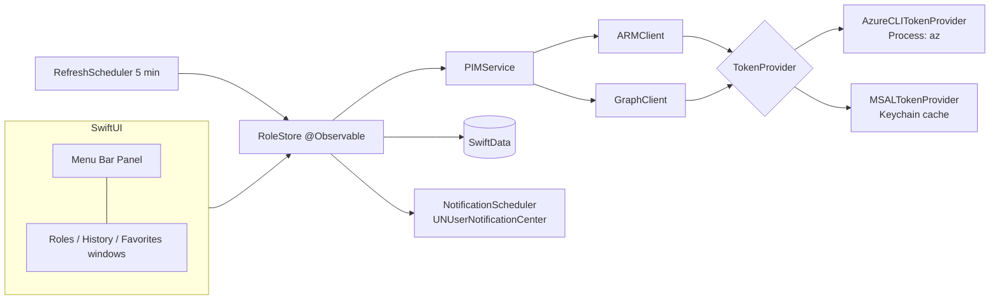

# AzurePim — Technical Requirements Document

## Platforms

- macOS **14 Sonoma** minimum, Apple silicon and Intel (universal binary).
- No iOS, Windows or Linux in v1.

## Frontend and hosting

- **SwiftUI** app, Swift 6 language mode, strict concurrency.
- `MenuBarExtra` (style `.window`) for the menu bar panel + a regular `Window` / `WindowGroup` for the desktop window and `Settings` scene.
- App runs as an agent by default (`LSUIElement = YES`, no Dock icon); the Dock icon appears while the main window is open (`NSApp.setActivationPolicy(.regular)` / `.accessory`).
- Launch at login via `SMAppService.mainApp`.
- **Distribution:** Developer ID–signed, notarized DMG built with `dmgbuild`, auto-update with **Sparkle 2** (appcast on GitHub Releases), per the `macos-app-release` pipeline. Artifacts in `release/`.
- **Mac App Store:** after v1, separate MSAL-only target (sandbox forbids launching `az`).

## Backend and database

- **No backend.** The app talks directly to Microsoft APIs (Azure Resource Manager and Microsoft Graph).
- Local storage only:
  - **SwiftData** store in `~/Library/Application Support/AzurePim/` for accounts metadata, favorites, history, cached roles.
  - **Keychain** for MSAL token cache (handled by MSAL) — no secret is ever written to SwiftData or UserDefaults.
  - `UserDefaults` for UI preferences only.

## Authentication and roles

No AzurePim account. The user signs in to Microsoft with one of two providers, behind a `TokenProvider` protocol
(`func token(for resource: Resource, account: Account, claims: String?) async throws -> AccessToken`):

| Provider | How | Covers | Consent needed |
|---|---|---|---|
| **AzureCLITokenProvider** | Runs `az account get-access-token --resource <res> --tenant <tid> -o json` with `Process` | Azure resource roles (ARM) | None (uses the Azure CLI first-party app) |
| **MSALTokenProvider** | MSAL for macOS (`microsoft-authentication-library-for-objc`, SPM), system browser / Enterprise SSO plug-in, multi-tenant public client | Azure resource roles + Entra roles + PIM groups | ARM `user_impersonation`: user consent. Directory scopes: **admin consent per tenant** |

Graph via the Azure CLI token is **not** possible for PIM: that token lacks `RoleAssignmentSchedule.*` and requesting it
fails with `AADSTS65002` (verified 2026-11-03).

**MSAL scopes (delegated):**

| Resource | Scope | Purpose | Admin consent |
|---|---|---|---|
| ARM | `https://management.azure.com/user_impersonation` | Azure resource PIM | No |
| Graph | `User.Read` | Profile, object id | No |
| Graph | `RoleEligibilitySchedule.Read.Directory` | List eligible Entra roles | Yes |
| Graph | `RoleAssignmentSchedule.ReadWrite.Directory` | Self-activate / deactivate / extend Entra roles | Yes |
| Graph | `RoleManagementPolicy.Read.Directory` | Read Entra role policies (max duration, ticket, MFA) | Yes |
| Graph | `PrivilegedEligibilitySchedule.Read.AzureADGroup` | List eligible PIM groups | Yes |
| Graph | `PrivilegedAssignmentSchedule.ReadWrite.AzureADGroup` | Self-activate PIM group membership/ownership | Yes |
| Graph | `RoleManagementPolicy.Read.AzureADGroup` | Read PIM group policies | Yes |

Directory scopes are requested **incrementally**, only when the user opens the Entra section, so that ARM works with
user consent alone.

App registration: multi-tenant (`AzureADMultipleOrgs`), public client, redirect URI
`msauth.com.vincentlauriat.azurepim://auth` *(assumption: bundle id `com.vincentlauriat.azurepim`)*, publisher
tenant owned by Vincent *(assumption — PRD open question 2)*, publisher verification via the Microsoft Partner
Network before public release.

## External services and APIs

| Provider | Usage | Limits / quotas | Who owns the credentials |
|---|---|---|---|
| Azure Resource Manager — `Microsoft.Authorization` (api-version `2020-10-01`) | `roleEligibilityScheduleInstances`, `roleAssignmentScheduleInstances` (`$filter=asTarget()`), `roleAssignmentScheduleRequests` (`SelfActivate`, `SelfDeactivate`, `SelfExtend`), `roleManagementPolicyAssignments` | ARM throttling ≈ 1,200 reads / 5 min per principal per tenant | The user (delegated token) |
| Microsoft Graph v1.0 — `roleManagement/directory` | `roleEligibilityScheduleInstances/filterByCurrentUser(on='principal')`, `roleAssignmentScheduleInstances/filterByCurrentUser`, `roleAssignmentScheduleRequests` (`selfActivate`, `selfDeactivate`, `selfExtend`), `filterByCurrentUser` on requests for history | Graph identity governance throttling (per app per tenant) | The user (delegated token) |
| Microsoft Graph v1.0 — `identityGovernance/privilegedAccess/group` | `eligibilityScheduleInstances`, `assignmentScheduleInstances`, `assignmentScheduleRequests` (`selfActivate`, `selfDeactivate`) | Same | The user |
| Microsoft identity platform | MSAL sign-in, admin-consent endpoint `/{tenant}/v2.0/adminconsent` | — | App registration owned by publisher tenant |
| Azure CLI (local) | Token source in CLI mode | Requires `az` ≥ 2.60 and a prior `az login` | The user |
| Sparkle / GitHub Releases | App updates (appcast + DMG) | GitHub release asset limits | Vincent (EdDSA update key in Keychain) |

## Architecture

- `PIMService` normalizes the three sources (Azure resources, Entra roles, PIM groups) into one `EligibleRole` /
  `ActiveAssignment` model with a `source` field.
- All network calls are `async`, run concurrently per account and source (`TaskGroup`), with a 20 s timeout.
- MFA / authentication context: when ARM or Graph returns a claims challenge (`WWW-Authenticate … claims=` /
  `acrs`), `MSALTokenProvider` re-authenticates interactively with those claims and retries once; in CLI mode the app
  shows the exact `az login --tenant … --scope …` command to run.

## Security and privacy

- Tokens never leave the Mac except to Microsoft endpoints; no AzurePim server, **no telemetry**.
- Tokens live only in memory (CLI mode) or in the MSAL Keychain cache; never logged. Logs use `os.Logger` with
  `privacy: .private` for UPNs, tenant ids and object ids.
- Hardened Runtime, no `com.apple.security.cs.*` exceptions. `Process` launches only the `az` binary chosen by the user
  or found at a known path, with an explicit argument array (no shell).
- History retention: 90 days by default, configurable 7–365; "Delete all local data" in Settings.
- Justification texts may contain ticket references — stored locally only, deleted with history.

## Performance and reliability targets

| Target | Value |
|---|---|
| Panel open → cached list visible | < 150 ms |
| Background refresh of one account (3 sources) | < 3 s p50, 20 s timeout |
| Activate button → request accepted (*Provisioned* / *PendingApproval*) | < 4 s p50 (Azure side ≈ 1–3 s) |
| Menu bar countdown update | every 60 s, every 1 s in the last 5 minutes |
| Idle CPU | < 0.5 % average; memory < 80 MB |
| Offline | Cached data shown with "last updated" time; actions disabled |

Reliability: retries with exponential backoff (1 s, 2 s, 4 s) on 429/5xx, honoring `Retry-After`. No backups needed
beyond the local store (Azure is the source of truth).

## Environments and release

- **Development:** Xcode (stable, never beta), scheme `AzurePim-Debug`, test tenant = Vincent's dev tenant; Voltalia
  tenant for real-world checks.
- **No staging server** (no backend). Release channel via Sparkle: `stable` only in v1.
- **CI:** GitHub Actions on macOS runner: build, unit tests (`swift test` for the core package), SwiftLint.
- **Release:** `Scripts/release.sh` → universal build → sign → `dmgbuild` → `notarytool submit --wait` → staple →
  appcast → GitHub release.

## Key technical decisions and trade-offs

| Choice | Reason | Alternative considered |
|---|---|---|
| SwiftUI `MenuBarExtra` (`.window`) | Native, little code, macOS 14 baseline | AppKit `NSStatusItem` + `NSPopover` (more control, more code) |
| `TokenProvider` protocol with two implementations | Both sign-ins in v1 + MSAL-only App Store build later | Single MSAL path (needs admin consent before any value) |
| Direct REST (ARM / Graph) with `URLSession` | 6–10 endpoints only; no heavy SDK | Microsoft Graph SDK (no official Swift SDK) |
| SwiftData for local data | macOS 14 baseline, little boilerplate | Core Data; JSON files |
| Multi-tenant public client app | One app for every tenant | Per-tenant registration (each admin registers their own; supported as fallback via a custom client-id field in Settings) |
| Polling every 5 min | No push API for PIM schedule changes | Graph change notifications (not available for role schedules) |
| Sparkle + DMG first | Allows Azure CLI mode (no sandbox) | Mac App Store first (forbids CLI mode) |
| Core logic in a Swift package `AzurePimCore` | Unit-testable without UI, reused by the App Store target | Everything in the app target |
